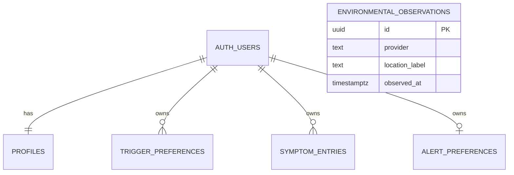

# Data Dictionary & ERD (PROPOSED v1.0 — mark Approved in the integration contract)

`environmental_observations` is shared reference data (not user-owned, no user_id).

Conventions: snake_case; UUID ids; `timestamptz` (stored UTC); `null` = missing, never zero; deleting an auth user cascades to all rows below.

## profiles
| Column | Type | Null | Notes |
|---|---|---|---|
| user_id | uuid PK → auth.users | no | auto-created on sign-up |
| display_name | text | yes | 1–80 chars; only client-writable column |
| created_at, updated_at | timestamptz | no | updated_at set by trigger |

## trigger_preferences
| Column | Type | Null | Notes |
|---|---|---|---|
| id | uuid PK | no | |
| user_id | uuid | no | must equal auth.uid() (RLS) |
| trigger_code | enum `trigger_code` | no | unique per user |
| enabled | boolean | no | default true |
| threshold_value / threshold_unit | numeric(8,2) / text | yes | both or neither; value ≥ 0; only if scientifically justified |
| created_at, updated_at | timestamptz | no | |

## symptom_entries (private health data)
| Column | Type | Null | Notes |
|---|---|---|---|
| id | uuid PK | no | |
| user_id | uuid | no | filled from auth.uid(); **not client-writable** |
| occurred_at | timestamptz | no | not > 5 min in future |
| symptom_labels | enum `symptom_label`[] | no | 1–5, no duplicates/nulls |
| severity | smallint | yes | 1–5 (PROPOSED scale) |
| notes | text | yes | ≤ 1000 chars; sensitive, never log |
| created_at, updated_at | timestamptz | no | |

Pagination index: `(user_id, occurred_at desc, id desc)`.

## environmental_observations
| Column | Type | Notes |
|---|---|---|
| provider, location_label | text | unique with observed_at |
| location_precision | enum | country/region/city/district |
| coarse_latitude/longitude | numeric(4,1) | ≤ 0.1° (~11 km) — never precise location |
| observed_at, fetched_at | timestamptz | |
| data_type | enum | observed / estimated / forecast |
| data_status | enum | available / partial / stale / unavailable / error |
| status_reason | text | required when unavailable/error |
| pm25_ugm3, pm10_ugm3, o3_ugm3, no2_ugm3, so2_ugm3 | numeric(7,2) | µg/m³, ≥ 0 |
| temperature_c | numeric(4,1) | °C |
| humidity_pct | numeric(4,1) | %, 0–100 |

View `environmental_context` returns the contract shape (units on every value, `Z` timestamps, `stale` if > 3 h old).

## alert_preferences (optional MVP)
`user_id` PK, `push_enabled`, `enabled_categories` (`air_quality`/`weather`/`pollen`), `quiet_hours_start/end` (both or neither), `timezone` (IANA name).

## Enum lists (PROPOSED)
- trigger_code: pm25, pm10, ozone, no2, so2, pollen, cold_air, heat, high_humidity, low_humidity, smoke, dust
- symptom_label: cough, wheeze, shortness_of_breath, chest_tightness, night_symptoms
- env_data_status: available, partial, stale, unavailable, error
- env_data_type: observed, estimated, forecast
